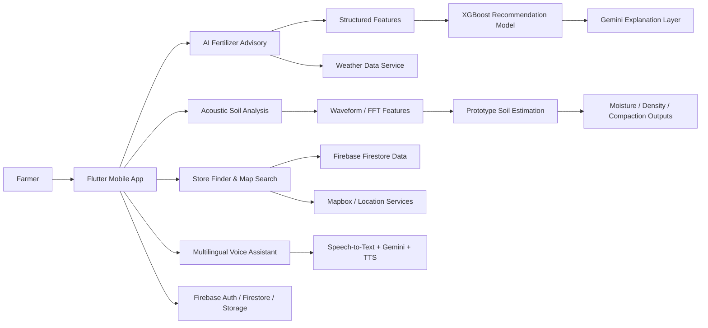

# Kisan Mitra – Smart Agriculture Decision Support System

A smart agriculture platform for farmers that combines AI-based fertilizer advisory, smartphone-based soil analysis concepts, nearby fertilizer-store discovery, and multilingual voice interaction in a single Flutter application.

---

## 1. Project title and short tagline

**Kisan Mitra – Smart Agriculture Decision Support System**

**Tagline:** Helping farmers make better crop and fertilizer decisions using AI, local data, voice interaction, and practical agronomic guidance.

---

## 2. Project overview

Kisan Mitra is designed to help farmers make informed decisions related to fertilizer use, soil condition, nearby input availability, and crop management support. The app brings together several capabilities:

- AI-based fertilizer recommendation using structured agronomic inputs
- Soil analysis support based on acoustic sensing concepts
- Nearby fertilizer store discovery with location-aware ranking
- Voice-first, multilingual interaction in English, Hindi, and Marathi
- Weather-aware advisory support integrated into the farmer workflow

The project reflects the evolution from a basic fertilizer-store finder toward an integrated agriculture decision support system that combines decision support, agricultural assistance, and local discovery within one mobile platform.

---

## 3. Problem statement

Farmers often need to make decisions with limited access to reliable agronomic support, soil diagnostics, and local input availability. The common challenges include:

- uncertainty around fertilizer type and dosage
- limited access to soil condition insights
- difficulty finding nearby stores with the required fertilizers
- language barriers in app interfaces and agricultural decision support
- lack of simple, mobile-first tools that can guide farmers in local languages

A practical agriculture assistance platform should make these decisions more accessible, understandable, and actionable for farmers without requiring advanced laboratory tools or technical expertise.

---

## 4. Proposed solution

Kisan Mitra proposes a unified platform that supports farmers through multiple pathways:

1. Structured recommendation engine for fertilizer choice and application guidance
2. Acoustic soil sensing prototype for quick field-level soil estimation
3. Local fertilizer-store search and ranking based on market availability and proximity
4. Multilingual AI assistant that can understand voice commands and trigger app actions
5. Weather-aware recommendations to improve context before fertilizer or irrigation decisions

The system is intended to support decisions in a farmer-friendly, low-friction format using a mobile application.

---

## 5. Key features

### Implemented / active in the app

- Firebase-based authentication and user management
- Farmer and store workflows with role-based app structure
- Fertilizer store discovery using map and location-based search
- Weather-aware advisory support
- AI voice assistant for navigation and guidance
- Multilingual support via Flutter localization
- Business logic for store and fertilizer data management in Firebase

### Prototype / experimental

- Acoustic soil analysis concept for smartphone audio-based sensing
- Soil estimation for moisture, density, and compaction
- On-device or edge inference concept using TensorFlow Lite / CNN models
- AI-generated natural-language explanation tied to acoustic soil results

### Planned / future direction

- Full continuous-learning loop from farmer feedback and agronomic outcomes
- Larger calibration dataset for agricultural soil sensing
- Broader field validation across soil types and crop conditions
- Deeper AI function-calling integration for voice-driven agricultural actions

---

## 6. System architecture



This architecture reflects the repository layout: Flutter app front-end, Firebase services for authentication and storage, map/location services for store discovery, and Gemini-based AI workflows for advisory and voice interaction.

---

## 7. End-to-end workflow

1. The farmer opens the app and selects their role.
2. They enter or provide crop, soil, and location information.
3. The advisory workflow combines agricultural context with weather and local conditions.
4. The recommendation engine suggests fertilizer type and dosage guidance using structured fields.
5. Gemini generates a simple, farmer-friendly explanation of the recommendation.
6. If the farmer needs local availability, the app helps locate nearby fertilizer stores.
7. If a soil check is required, the acoustic analysis flow can process microphone-based data as a prototype soil estimate.
8. The voice assistant can help trigger actions such as fertilizer search, advisory retrieval, soil-analysis initiation, and navigation where implemented.

---

## 8. AI/ML methodology

### Recommendation model

The current project direction uses a structured ML approach for fertilizer recommendation.

- Input features include:
  - crop type
  - soil NPK values
  - soil pH
  - location
  - weather conditions
- The model concept is based on **XGBoost** for fertilizer type and dosage prediction.
- The model is used to generate structured recommendation output based on agronomic features.
- **Google Gemini is used as a second layer to explain the recommendation in a simple, understandable farmer-friendly format.**
- The LLM should explain the recommendation rather than independently determine the fertilizer dosage.

### Design principle

This separation is important:

- XGBoost handles the structured data-driven recommendation logic.
- Gemini explains the recommendation in plain language for agricultural users.
- The system should not rely on an LLM to make the final dosage decision without the structured model output.

---

## 9. Acoustic soil analysis methodology

This is a key prototype area in the project and should be considered experimental.

### Conceptual approach

The repository includes a soil-acoustic feature aimed at estimating field soil properties using smartphone-based sensing. The concept includes:

- smartphone microphone/speaker-based soil analysis
- acoustic chirp sensing such as FMCW-style methods
- metal-rod impact acoustic sensing
- waveform and FFT-based signal processing
- TensorFlow Lite / CNN concept for on-device inference

### Intended outputs

The project aims to estimate:

- soil moisture
- soil density
- soil compaction

### Important note

This feature is best described as **prototype / experimental** and requires calibration and validation against reference soil measurements before being treated as a field-accurate diagnostic tool. The repository does not present laboratory-validated accuracy claims or a complete field-validated soil model.

---

## 10. Fertilizer store ranking algorithm

The project is designed to help farmers find the best nearby store for required fertilizer inputs. The latest platform direction uses a weighted scoring model for store recommendation.

### Recommended ranking formula

- Price: 40%
- Distance: 30%
- Stock availability: 20%
- Rating: 10%

### Interpretation

- lower price is preferred
- shorter distance is preferred
- available stock increases confidence in immediate purchase
- stronger user rating adds confidence to the shop recommendation

The model produces a “Best Shop” recommendation based on the weighted score, with map-based discovery supporting local navigation and selection.

> Note: the repository currently contains a ranking implementation with a different relative weight distribution, but the latest project description reflects the upgraded platform concept described above.

---

## 11. Multilingual voice assistant

Kisan Mitra includes a voice-first interaction layer intended for farmers in rural and semi-urban settings.

### Supported languages

- English
- Hindi
- Marathi

### Voice capabilities

- Speech-to-Text
- Google Gemini for intent understanding and conversational response
- Gemini Function Calling / Google ADK concept for action-oriented interactions
- Flutter TTS for response playback
- ElevenLabs as an optional advanced voice synthesis path

### Functional role

The voice assistant is intended to act as an interface capable of triggering application functions such as:

- fertilizer search
- advisory retrieval
- soil-analysis initiation
- store navigation
- general agricultural guidance

The voice assistant is meant to reduce friction for users who prefer speaking rather than entering text manually.

---

## 12. Technology stack

### Mobile

- Flutter (Dart)

### UI

- Material Design 3
- Google Fonts

### Backend / Cloud

- Firebase Authentication
- Firebase Firestore
- Firebase Storage


### ML

- Python
- scikit-learn
- XGBoost

### Edge ML

- TensorFlow Lite
- CNN concept for acoustic soil analysis

### AI

- Google Gemini
- Gemini Function Calling
- Google ADK concept

### Voice

- Google Speech-to-Text
- Flutter TTS
- ElevenLabs

### Localization

- Flutter Intl
- English
- Hindi
- Marathi

### Maps / Location

- Mapbox Maps Flutter
- Flutter Map
- OpenStreetMap
- Geolocator
- Geocoding

### Weather

- OpenWeather API

---

## 13. User roles

| Role | Purpose |
|------|---------|
| Farmer | Access recommendations, find stores, use advisory features, interact through voice assistant |
| Store owner | Manage fertilizer inventory, store location, and stock information |
| Admin | Oversee platform data, verification workflow, and operational management |

The repository contains role-based screens and flows for farmers, stores, and administrators.

---

## 14. Project evolution

The project has evolved from the earlier concept of a basic fertilizer-store finder into a more complete agricultural support platform.

### Original direction

- fertilizer availability
- nearby store discovery
- basic crop and advisory support

### Current direction

- AI-backed fertilizer recommendation
- weather-aware support
- soil analysis prototype
- multilingual voice interaction
- broader decision support for farmers

This evolution reflects the project’s transition from a simple marketplace-oriented app into a Smart Agriculture Decision Support System.

---

## 15. Project structure

The repository structure is consistent with a Flutter multi-role application and includes the following major areas:

```text
kisan_mitra/
├── lib/
│   ├── core/
│   │   ├── constants/
│   │   ├── controllers/
│   │   ├── localization/
│   │   ├── services/
│   │   ├── utils/
│   │   └── widgets/
│   ├── features/
│   │   ├── admin/
│   │   ├── auth/
│   │   ├── farmer/
│   │   ├── soil_acoustic/
│   │   └── store/
│   ├── l10n/
│   └── main.dart
├── android/
├── ios/
├── web/
├── windows/
├── linux/
├── macos/
├── assets/
├── test/
├── firebase_options.dart
├── firestore.indexes.json
├── firestore.rules
├── pubspec.yaml
├── analysis_options.yaml
├── l10n.yaml
├── README.md
└── .env
```

This structure supports the application’s modular role-based architecture and the presence of separate farmer, store, admin, and acoustic-analysis components.

---

## 16. Setup and installation instructions

### Prerequisites

- Flutter SDK 3.10.8 or later
- Dart SDK bundled with Flutter
- Android Studio or VS Code with Flutter and Dart support
- Firebase project access
- Mapbox access token for map features
- API keys for Gemini and voice services as required by the project configuration

### Install dependencies

```bash
flutter pub get
```

### Run the app

```bash
flutter run
```

### Generate localization files

```bash
flutter gen-l10n
```

### Build for Android

```bash
flutter build apk --release
```

---

## 17. Environment variables / API configuration

The project uses Flutter environment loading and includes configuration values in a project-root `.env` file. The repository currently contains the following relevant values:

```env
GEMINI_API_KEY=your_gemini_api_key
ELEVEN_LABS_API_KEY=your_elevenlabs_key
```

Additional actual repository facts:

- `flutter_dotenv` is included in the app dependencies and the project loads `.env` values at runtime.
- Mapbox access is configured in the Android app resources, including `android/app/src/main/res/values/strings.xml`.
- The app code also checks for `OPENAI_API_KEY` as a fallback in the AI service, but the main repository configuration seen here uses Gemini and ElevenLabs keys.
- The weather service currently contains an OpenWeather API key constant in the code, which should be externalized for production use.

> Security note: environment files and private keys should never be committed to shared repositories.

---

## 18. Current implementation status

### Implemented

- Flutter mobile application with role-based navigation
- Firebase-based authentication and data persistence
- Farmer dashboard and advisory workflow
- Map-based fertilizer store search
- Weather-aware advisory logic
- Multilingual localization support
- AI voice assistant integration using Gemini and TTS
- Firebase-admin store and fertilizer management flows

### Prototype / experimental

- acoustic soil analysis with waveform/FFT-based feature processing
- soil moisture, density, and compaction estimation concept
- TensorFlow Lite / CNN-based edge inference concept
- AI explanation layer for soil results and recommendations

### Planned / future

- stronger field calibration for soil acoustic features
- larger real-world validation set
- feedback-driven model improvement using farmer outcomes
- more advanced voice function calling and assistant actions
- continuous improvement pipeline based on soil, weather, and agronomic feedback

---

## 19. Limitations

- Acoustic soil analysis is still an experimental prototype and should not be treated as a validated laboratory-grade measurement system.
- The project requires reliable access to Mapbox, Firebase, Gemini, and weather-service configuration for full feature operation.
- The advisory system is intended to support decision-making, but crop and fertilizer planning still requires agronomic validation and localized knowledge.
- The project is a student / hackathon-style technical platform and should be considered an evolving research and product prototype rather than a fully field-certified agronomy system.

---

## 20. Future scope

The roadmap for Kisan Mitra includes:

- integrating more robust field-level agronomic recommendations
- expanding soil sensing with calibrated reference datasets
- improving multilingual voice actions and regional language support
- linking crop outcomes, farmer feedback, soil data, and weather data for iterative improvement
- building a stronger local-market ecosystem for fertilizer recommendations and store discovery

A long-term direction could include a continuous improvement mechanism in which real farm outcomes inform future recommendation quality, but this should be treated as a future engineering goal rather than an already deployed automatic learning pipeline.

---

## 21. Team / project information

No dedicated team or institutional project information is present in the current repository README beyond the product description itself. This project is presented as a technical agriculture platform built around the Kisan Mitra concept.

---

## Summary

Kisan Mitra is a modern agriculture decision-support application that evolves beyond a simple fertilizer finder into a platform for advisory, store discovery, and voice-enabled farmer assistance. Its core strengths are the fusion of structured agronomic recommendation logic, weather-aware support, map-based store discovery, multilingual voice interaction, and an experimental acoustic soil-analysis workflow. The system is well aligned with a practical smart-farming use case while clearly separating implemented features from prototype and future work.

| Language | Code |
|----------|------|
| English | `en` |
| Hindi | `hi` |
| Marathi | `mr` |

Localization strings are defined in `lib/l10n/` as ARB files and configured via `l10n.yaml`.

---

## 🤝 Contributing

Contributions are welcome! Please follow these steps:

1. Fork the repository
2. Create a feature branch: `git checkout -b feature/your-feature-name`
3. Commit your changes: `git commit -m 'Add some feature'`
4. Push to the branch: `git push origin feature/your-feature-name`
5. Open a Pull Request

---

## 📄 License

This project is licensed under the MIT License. See the [LICENSE](LICENSE) file for details.

---

<p align="center">Made with ❤️ for Indian farmers</p>
